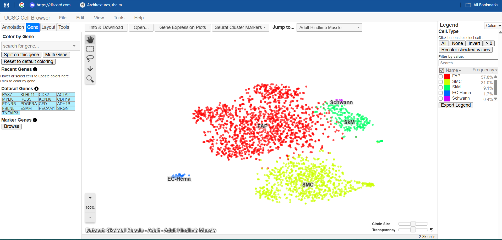
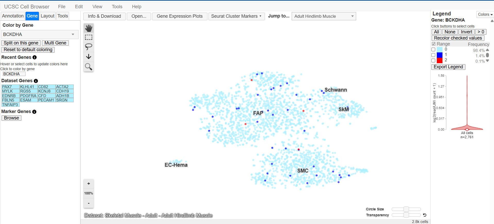
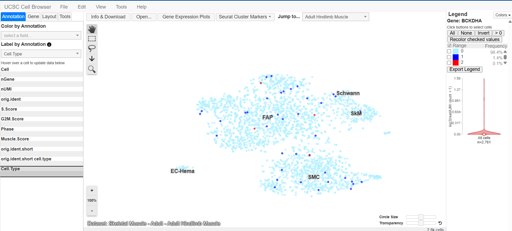
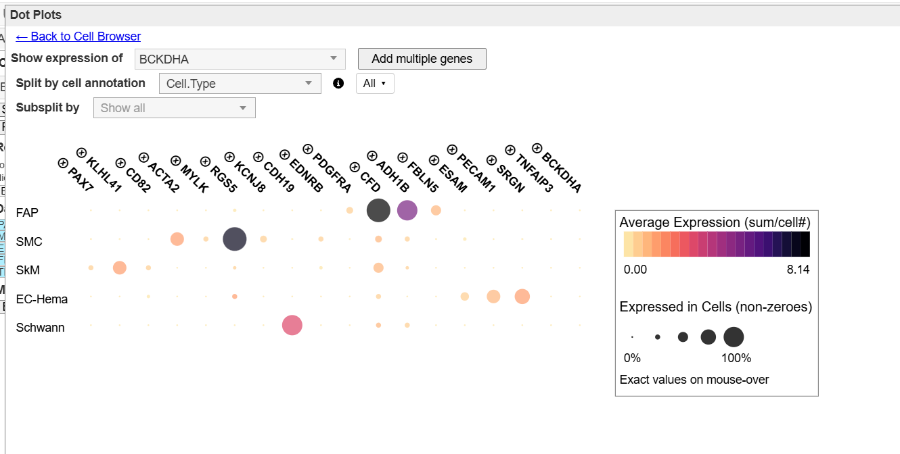
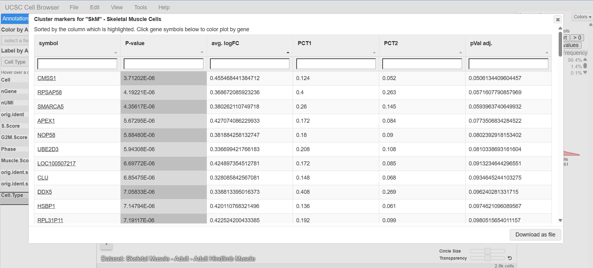
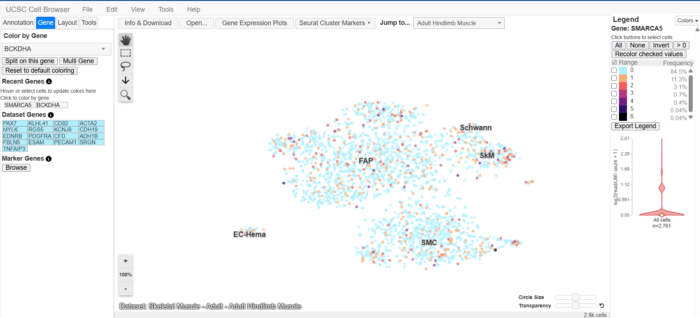

# UCSC Cell Browser Activity
## From Genome to Cell: Exploring Disease Gene Using the UCSC Cell Browser

**Course:** Cell and Molecular Biology Laboratory  
**Assigned Gene:** BCKDHA  
**Associated Disease:** Maple Syrup Urine Disease (MSUD)  
**Organism:** *Homo sapiens*  
**Database:** UCSC Cell Browser  

---

## PART A. Assigned Gene and Disease

### Assigned Gene: BCKDHA

**Official Gene Name:** Branched Chain Keto Acid Dehydrogenase E1 Subunit Alpha

**Associated Disease:** Maple Syrup Urine Disease (MSUD), Type IA

### Biological Function

The BCKDHA gene encodes the E1 alpha subunit of the mitochondrial branched-chain alpha-keto acid dehydrogenase (BCKD) complex. This enzyme complex is involved in the breakdown of the branched-chain amino acids leucine, isoleucine, and valine. Mutations in BCKDHA can impair the function of the enzyme complex, causing these amino acids and their metabolic byproducts to accumulate in the body. This metabolic impairment is associated with Maple Syrup Urine Disease (MSUD), an inherited disorder that can cause serious neurological complications.

---

## PART B. Organ/Tissue Choice and Dataset Information

### Selected Dataset

| Information | Details |
|---|---|
| Assigned Gene | BCKDHA |
| Associated Disease | Maple Syrup Urine Disease (MSUD) |
| Dataset Name | Adult Hindlimb Muscle |
| Dataset Collection | Skeletal Muscle – Adult |
| Organism | *Homo sapiens* |
| Organ/Tissue | Human Skeletal Muscle |
| Number of Cells Analyzed | 2,761 |
| Visualization | Seurat t-SNE |

**Dataset URL:**  
https://cells.ucsc.edu/?ds=skeletal-muscle+adult+adult-hindlimb

### Why was this organ/tissue selected?

Human skeletal muscle was selected because it plays an important role in branched-chain amino acid metabolism, which is affected in Maple Syrup Urine Disease. Since BCKDHA encodes a mitochondrial enzyme subunit involved in this process, examining skeletal muscle-associated cells provides a relevant biological context for investigating its expression.

### Required Proof — Screenshot 1

**Figure 1. Adult Hindlimb Muscle Dataset in the UCSC Cell Browser.** The selected dataset represents human skeletal muscle-associated cell populations and was used to investigate the single-cell expression of BCKDHA.

---

## PART C. Understanding the Cell Map

### a. What type of visualization is being shown (UMAP, t-SNE, or another layout)?

The dataset uses a Seurat t-SNE (t-distributed Stochastic Neighbor Embedding) visualization. This method displays individual cells in a two-dimensional map based on similarities in their overall gene-expression profiles.

### b. What does one dot represent?

Each dot represents an individual cell analyzed in the Adult Hindlimb Muscle dataset. The position of each dot reflects similarities in gene-expression profiles rather than the physical location of the cell within the body.

### c. What do the clusters represent in this particular dataset?

The clusters represent groups of cells with similar gene-expression profiles. In this dataset, they correspond to different skeletal muscle-associated cell populations, including fibro-adipogenic progenitors, smooth muscle cells, skeletal muscle cells, endothelial/hematopoietic cells, and Schwann cells.

### d. List at least three cell-type or cluster labels visible in the dataset.

Five cell-type clusters were identified:

| Cluster | Cell Type | Percentage |
|---|---|---|
| FAP | Fibro-adipogenic progenitors | 57.8% |
| SMC | Smooth muscle cells | 31.0% |
| SkM | Skeletal muscle cells | 9.1% |
| EC-Hema | Endothelial/hematopoietic cells | 1.7% |
| Schwann | Schwann cells | 0.4% |

These percentages represent the relative proportions of cells in the dataset rather than their BCKDHA expression levels.

---

## PART D. Search for the Assigned Gene

### a. Assigned gene symbol

BCKDHA

### b. Dataset used

Adult Hindlimb Muscle from the Skeletal Muscle – Adult collection of the UCSC Cell Browser.

### c. Is expression widespread, restricted, or low/undetected?

BCKDHA showed low or undetected expression in most cells. Only a small proportion of cells displayed detectable expression, indicating a sparse expression pattern across the dataset.

### d. Which cluster(s) appear to contain cells with stronger expression?

Detectable BCKDHA expression was observed in FAP, SMC, and SkM cells. The dot plot showed that these three clusters had the same reported average expression of 0.02, while SMC and SkM had the highest reported proportion of expressing cells at approximately 2%.

### e. Which cluster(s) appear to contain little or no detectable expression?

EC-Hema and Schwann cells showed no detectable BCKDHA expression. Both clusters had 0% expressing cells and an average expression value of 0.00.

### Required Proof — Screenshot 2

**Figure 2. BCKDHA Gene Expression Across Adult Hindlimb Muscle Cells.** The Seurat t-SNE visualization shows predominantly low or undetected BCKDHA expression, with only scattered cells displaying detectable expression across several cell populations.

---

## PART E. Identify the Cell Types Expressing BCKDHA

### a. Cell type/cluster with the strongest visible expression

FAP, SMC, and SkM showed the same reported average BCKDHA expression of 0.02. However, SMC and SkM had the highest reported proportion of expressing cells, approximately 2%, compared with 1% in FAP.

### b. Another cell type/cluster with detectable expression

BCKDHA was also detected in FAP cells, where 23 out of 1,595 cells showed non-zero expression.

### c. Cell type/cluster with relatively low or undetected expression

EC-Hema and Schwann cells showed no detectable expression, with average expression values of 0.00.

### d. Is the expression pattern broad or cell-type restricted?

BCKDHA showed sparse expression across multiple cell types rather than a strongly cell-type-restricted pattern. Detectable expression was distributed among FAP, SMC, and SkM cells.

### e. In 2–3 sentences, give a possible biological explanation for the observed pattern. Clearly state that this is an interpretation based on the selected dataset.

BCKDHA participates in mitochondrial branched-chain amino acid metabolism, a process relevant to different cell types. Its low and scattered expression in FAP, SMC, and SkM cells may reflect differences in cellular metabolic activity or limitations in detecting low-abundance transcripts through single-cell RNA sequencing. Based on this dataset, the absence of detectable expression in EC-Hema and Schwann cells does not necessarily indicate that the gene is biologically inactive in these cells.

### Required Proof — Screenshot 3

**Figure 3. BCKDHA Expression Across Identified Cell-Type Clusters.** The visualization identifies FAP, SMC, SkM, EC-Hema, and Schwann cell populations. Detectable BCKDHA expression appears in scattered cells within FAP, SMC, and SkM, while EC-Hema and Schwann show no detectable expression in this dataset.

---

## PART F. Select Cells and Examine an Expression Plot

The Gene Expression Plots feature of the UCSC Cell Browser was used to compare BCKDHA expression among the five identified cell types. A dot plot was examined using `Cell.Type` as the cell annotation.

### BCKDHA Expression Results

| Cell Type | Total Cells | Cells with Detectable Expression | Average Expression |
|---|---|---|---|
| FAP | 1,595 | 23 (1%) | 0.02 |
| SMC | 857 | 16 (2%) | 0.02 |
| SkM | 250 | 5 (2%) | 0.02 |
| EC-Hema | 48 | 0 (0%) | 0.00 |
| Schwann | 11 | 0 (0%) | 0.00 |

*Note: Percentages and average expression values are reported as displayed by the UCSC Cell Browser.*

### a. Which cells/cluster did you select?

Rather than selecting a single cluster using the cell-selection tool, the Gene Expression Plots feature was used to compare all five annotated cell types: FAP, SMC, SkM, EC-Hema, and Schwann cells.

### b. Does your selected group show higher, lower, or similar expression compared with the comparison cells?

FAP, SMC, and SkM showed similar average BCKDHA expression levels of 0.02. SMC and SkM had a slightly higher proportion of expressing cells at approximately 2%, compared with 1% in FAP. In contrast, EC-Hema and Schwann cells showed no detectable expression.

### c. What does the expression plot add that was not obvious from the UMAP/t-SNE map?

The dot plot provided quantitative information about BCKDHA expression that was not immediately apparent from the t-SNE visualization. It showed the average expression values and the proportion of cells with detectable expression within each cluster. This allowed a more accurate comparison of BCKDHA expression among the different cell types.

### Interpretation

The dot plot revealed that BCKDHA was expressed at very low levels across the Adult Hindlimb Muscle dataset. Among the 2,761 cells analyzed, only 44 cells had detectable BCKDHA expression. FAP, SMC, and SkM had similar average expression values of 0.02, while EC-Hema and Schwann cells showed no detectable expression. These results suggest that BCKDHA expression was sparse across the sampled skeletal muscle-associated cells rather than strongly concentrated in one particular cell population.

### Required Proof — Screenshot 4

**Figure 4. Dot Plot Comparison of BCKDHA Expression Among Cell Types.** The plot displays gene expression across five annotated cell populations. Dot size represents the proportion of cells with non-zero expression, while dot color represents the average expression level. BCKDHA was detected in only a small proportion of FAP, SMC, and SkM cells.

---

## PART G. Explore Marker Genes

### a. Cluster/cell type examined

**SkM (Skeletal Muscle Cells)**

The SkM cluster was selected because skeletal muscle is biologically relevant to branched-chain amino acid metabolism and the function of BCKDHA.

### b–d. Marker genes identified

Three candidate marker genes were recorded from the Seurat Cluster Markers table for SkM.

| Candidate Marker Gene | P-value | Adjusted P-value |
|---|---|---|
| CMSS1 | 3.71202 × 10⁻⁶ | 0.0506 |
| RPSAP58 | 4.19221 × 10⁻⁶ | 0.0572 |
| SMARCA5 | 4.35617 × 10⁻⁶ | 0.0594 |

These genes were listed in the SkM marker table. However, their adjusted P-values were greater than 0.05, so they were treated as candidate markers rather than statistically significant markers at the 0.05 threshold.

### e. Does your assigned gene behave like a cell-type marker in this dataset? Explain briefly.

BCKDHA does not appear to behave like a specific cell-type marker in this dataset. Its expression was low and scattered among FAP, SMC, and SkM cells rather than strongly concentrated in the SkM cluster. This suggests that BCKDHA is associated with a metabolic function rather than uniquely identifying a specific cell population.

### Required Proof — Screenshot 5

**Figure 5. Candidate Marker Genes Identified in the SkM Cluster.** The Seurat Cluster Markers table displays genes associated with the skeletal muscle cell cluster, including CMSS1, RPSAP58, and SMARCA5, together with their statistical values.

---

## PART H. Compare BCKDHA With One Marker Gene

### a. Assigned disease gene

BCKDHA

### b. Marker gene

SMARCA5

SMARCA5 was selected from the SkM candidate marker-gene table for comparison with BCKDHA.

### c. Which gene shows a more cell-type-restricted expression pattern?

Neither gene demonstrated strong cell-type-restricted expression in this dataset. BCKDHA showed sparse detectable expression in FAP, SMC, and SkM cells, while SMARCA5 was detected across several cell populations. Although BCKDHA was detected in fewer cells, it was not exclusive to one particular cell type.

### d. Which gene appears more broadly expressed?

SMARCA5 appeared more broadly expressed because a larger number of cells across the different clusters showed detectable expression compared with BCKDHA.

### e. What does this comparison teach you about the difference between a disease-associated gene and a cell-type marker gene?

The comparison demonstrates that a disease-associated gene does not necessarily function as a cell-type marker. BCKDHA is associated with Maple Syrup Urine Disease because of its important role in amino acid metabolism, but its expression was low in this dataset. SMARCA5 showed broader expression despite being listed among the SkM candidate marker genes. This indicates that disease association and cell-type specificity represent different biological characteristics.

### Additional Evidence — SMARCA5 Expression Map

**Figure 6. SMARCA5 Expression Across Adult Hindlimb Muscle Cells.** SMARCA5 showed more widespread detectable expression across several cell populations compared with the sparse expression pattern observed for BCKDHA.

---

## PART I. Connect the Cell Browser Result to the Previous Genome Activity

### Chromosome Location → Gene Structure → Disease-Associated Variant → Gene Expression → Cell Type/Tissue

The previous UCSC Genome Browser and ClinVar activity investigated the genomic location, structure, and disease-associated mutation of BCKDHA. The present UCSC Cell Browser activity extends the analysis by examining BCKDHA expression in different skeletal muscle-associated cell populations.

### 1. On which chromosome is your assigned gene located? Use your previous UCSC Genome Browser activity.

BCKDHA is located on chromosome 19, at approximately chr19:41,397,818–41,425,002 in the GRCh38/hg38 human genome assembly. The gene is located on the negative DNA strand.

The previously examined transcript contained nine identifiable exons.

### 2. What disease-associated variant did you examine previously?

The previously examined variant was **NM_000709.4(BCKDHA):c.929C>G (p.Thr310Arg)**, associated with Maple Syrup Urine Disease.

This missense variant changes the coding nucleotide from cytosine to guanine at position 929, resulting in an amino acid substitution from threonine to arginine at position 310 of the BCKDHA protein.

The previous activity recorded the following information:

| Information | Result |
|---|---|
| Gene | BCKDHA |
| Reference Transcript | NM_000709.4 |
| Variant | c.929C>G |
| Protein Consequence | p.Thr310Arg |
| Mutation Type | Missense |
| Associated Disease | Maple Syrup Urine Disease |
| ClinVar Variation ID | 2381 |
| Previously Recorded Clinical Significance | Pathogenic/Likely pathogenic |

### 3. In the current Cell Browser dataset, which cell type(s) express the gene?

BCKDHA expression was detected in FAP, SMC, and SkM cells. The average expression was 0.02 in each of these clusters, with approximately 1–2% of cells showing detectable expression. No detectable expression was observed in EC-Hema and Schwann cells.

### 4. Does the observed cell expression make biological sense based on what you already know about the gene's function or associated disease? Explain in 3–5 sentences.

Yes, the observed expression is biologically reasonable because BCKDHA encodes a mitochondrial enzyme subunit involved in branched-chain amino acid metabolism. Detectable expression in FAP, SMC, and SkM cells is consistent with the gene's metabolic function in different cell populations. However, expression was generally low, which may reflect differences in cellular activity or limitations of single-cell RNA sequencing. These results suggest that BCKDHA may contribute to metabolic processes in skeletal muscle-associated cells, although its expression was not strongly concentrated in any particular cluster.

### 5. Can this single Cell Browser dataset prove that the gene causes the disease? Explain why or why not.

No, a single Cell Browser dataset cannot prove that BCKDHA causes Maple Syrup Urine Disease because it only shows gene-expression patterns in the sampled cells. Establishing a causal relationship requires additional evidence, such as genetic studies, pathogenic variant classifications, and functional experiments demonstrating how mutations affect enzyme activity. The Cell Browser results provide information about where the gene is expressed but do not directly establish disease causation.

### Integration of Findings

| Level of Investigation | Finding |
|---|---|
| Chromosome Location | Chromosome 19, negative strand |
| Gene Structure | Nine exons in the previously selected transcript |
| Disease-Associated Variant | c.929C>G (p.Thr310Arg) |
| Gene Expression | Low and scattered expression |
| Cell Types Expressing BCKDHA | FAP, SMC, and SkM |
| Tissue Examined | Adult human skeletal muscle |

**Previous Activity Repository:**  
https://github.com/zenasdeguit/Deguit_UCSC_ClinVar_Disease_BCKDHA_Lab_Activity

---

## PART J. Short Reflection

### 1. What did the UCSC Cell Browser show you that the UCSC Genome Browser could not?

The UCSC Cell Browser showed how BCKDHA expression varies among different cell types in skeletal muscle tissue. Unlike the UCSC Genome Browser, which focuses on genomic location, gene structure, and genetic variants, the Cell Browser allowed us to identify which cell populations expressed BCKDHA and compare their expression levels.

### 2. Why can the same gene have different expression levels among different cell types?

Different cell types have specialized functions and metabolic requirements, which influence their gene-expression levels. Although BCKDHA participates in branched-chain amino acid metabolism, its expression may vary depending on the metabolic activity and physiological state of each cell.

### 3. Why should you be careful when interpreting a gene that shows zero or very low expression in single-cell data?

Low or undetected expression does not necessarily mean that a gene is biologically inactive. Single-cell RNA sequencing may fail to detect transcripts because of technical limitations, low transcript abundance, or differences in cellular activity. Therefore, the absence of detectable BCKDHA expression in EC-Hema and Schwann cells should not be interpreted as complete gene inactivity.

### 4. Why is it useful to combine information about genomic location, genetic variants, and cell-specific gene expression?

Combining these types of information provides a more complete understanding of a gene's biological function and disease association. Genomic location identifies where BCKDHA is found, genetic variants reveal possible effects on protein function, and cell-specific expression shows where its transcripts are detected. Together, these findings help explain the molecular basis of Maple Syrup Urine Disease.

### 5. What was the most interesting observation you made about your assigned gene?

The most interesting observation was that BCKDHA showed very low expression despite its important role in amino acid metabolism. Only approximately 1–2% of FAP, SMC, and SkM cells showed detectable expression, while EC-Hema and Schwann cells showed none. This demonstrates that a gene associated with a serious metabolic disorder does not necessarily exhibit high expression in every cell type.

---

## Conclusion

The UCSC Cell Browser analysis provided information about the expression of BCKDHA in different cell populations within the Adult Hindlimb Muscle dataset. The Seurat t-SNE visualization identified five major cell types, while the expression analysis revealed low and scattered BCKDHA expression in FAP, SMC, and SkM cells. No detectable expression was observed in EC-Hema and Schwann cells.

The dot plot provided additional quantitative information about average expression and the proportion of cells expressing BCKDHA. Comparison with SMARCA5 demonstrated that genes can show different expression distributions across cell populations, and that a disease-associated gene does not necessarily function as a cell-type marker.

Overall, combining the UCSC Cell Browser findings with previous genomic and variant analyses provided a broader understanding of BCKDHA, its biological function, and its association with Maple Syrup Urine Disease. The activity also demonstrated the importance of interpreting single-cell expression results carefully, particularly when expression is low or undetected.

---

## References and Database Links

1. **UCSC Cell Browser.** Adult Hindlimb Muscle Dataset. Accessed October 12, 2026.  
   https://cells.ucsc.edu/?ds=skeletal-muscle

2. **UCSC Cell Browser.** Getting Started Guide.  
   https://cellbrowser.readthedocs.io/en/master/ui/getting_started.html

3. **UCSC Cell Browser.** Visualization Guide.  
   https://cellbrowser.readthedocs.io/en/master/ui/visualization.html

4. **UCSC Cell Browser.** Analysis Guide.  
   https://cellbrowser.readthedocs.io/en/master/ui/analysis.html

5. **National Center for Biotechnology Information (NCBI).** BCKDHA – Branched Chain Keto Acid Dehydrogenase E1 Subunit Alpha.  
   https://www.ncbi.nlm.nih.gov/gene/593

6. **National Center for Biotechnology Information (NCBI).** ClinVar Variation ID 2381.  
   https://www.ncbi.nlm.nih.gov/clinvar/variation/2381/

7. **Previous UCSC Genome Browser and ClinVar Laboratory Activity.** BCKDHA/MSUD genomic and variant investigation.  
   https://github.com/zenasdeguit/Deguit_UCSC_ClinVar_Disease_BCKDHA_Lab_Activity
